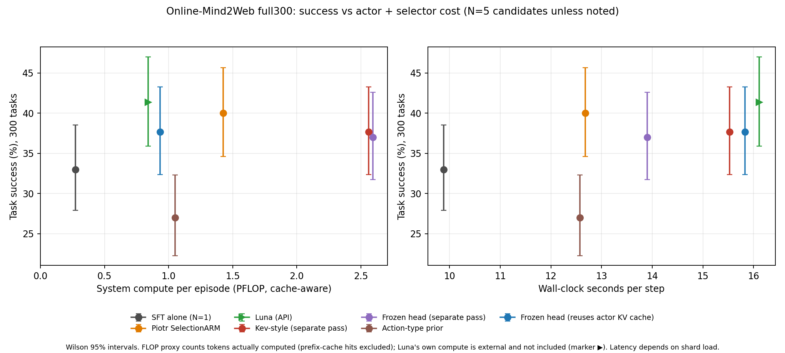

# ARM selection head: choosing actions from the actor's own hidden states

**No selector trained on teacher labels reliably picks actions that succeed more often than a uniform pick. Choosing by observed continuation outcomes does.** On 138 branching states with eight SFT continuation draws per action (120 task groups), each selector's chosen action is scored on held-out draws. Choosing the action that succeeded most often on five draws reaches **36.99%** against **31.67%** for a uniform pick: **+5.32 pp [+3.09, +7.62]**. Piotr SelectionARM reaches 34.15% (+2.48 pp [−0.14, +5.21]). Every actor-based selector lies between 31.34% and 33.70%, from −0.33 to +2.03 pp relative to uniform, and none differs from uniform at the 95% level.

**Agreement with teachers does not track action quality.** The Kev-style decision pass on the actor's weights, trained to step 600, matches held-out GPT-5.5 choices best of any actor-based selector: 67.1%, versus 65.4% for the frozen-feature head. On the original 124 states it matches an independent teacher (Luna before execution) on 66.1% of judgments, versus 73.2% for Piotr ARM. Its chosen actions succeed on 32.79% of held-out draws, +1.12 pp [−1.38, +3.75] over uniform.

**Supervising the selector with outcomes needs more states than exist now.** 188 states have eight draws for all five actions: 9,720 outcomes in 151 task groups, 14× fewer states than the 2,692 teacher-labelled training states ([data comparison](#selection-head-outcome-data-20261010)). A pre-registered five-fold [adaptation pilot](#selection-head-outcome-adaptation-20261010) on 138 of these states overfits: it fits training folds but does not beat uniform on held-out tasks. Ridge probes, a combined teacher-plus-outcome loss and selector combinations also find [no held-out gain](#selection-head-early-signal-20261010). Confirming a 3 pp selector difference needs about 200 states with eight draws, and confirming Piotr's ~2.5 pp gain over uniform about 300.

The question is whether selection can be built into the actor ([integration option 3](ARM_INTEGRATION_PLAN.md)). Today's best-of-N pipeline samples five candidates from the actor, then runs a separate 4B selector over the screenshot and all candidates. A head that reads the hidden states the actor computes while generating would need no second model.

**In full Online-Mind2Web episodes, Luna is the only new selector that beats the SFT actor alone.** On 300 tasks, Luna reaches 41.3% (+8.3 pp [+3.3, +13.7]), level with Piotr ARM at 40.0%. The Kev-style pass (37.7%) and the frozen head (37.0%) sit between the SFT actor and Piotr ARM; neither difference is significant. The action-type prior is worse than one sample (27.0%). **A frozen head that reuses the actor's KV cache cuts system compute by 36% per step relative to Piotr ARM** (0.060 versus 0.094 PFLOP). Its features come from the actor's own generation pass, so the selector adds 375 tokens per episode against Piotr's 58,000. It reaches 37.7%, 2.3 pp [−7.3, +2.7] below Piotr ARM, not significant. Wall-clock time per step is not lower in this implementation ([live-loop results](#selection-head-om2w-20261011), [plot](#selection-head-om2w-plot)).

[PNG](arm_results/methods/selection_head_workflows.png) / [SVG](arm_results/methods/selection_head_workflows.svg); rendered by `scripts/render_selection_head_figure.py`.

## Full episodes on Online-Mind2Web: selectors in the live loop

**In the live loop on Online-Mind2Web, the actor-based selectors land between the SFT actor and Piotr ARM, and neither result is significant.** Each condition ran the 300 Online-Mind2Web tasks (one episode per task). Every condition except SFT alone samples five candidates from the SFT actor at each step and executes the selector's pick. These are the tasks of the October 7 controls under the identical protocol, and they are paired by task with those controls. The protocol is T=0.7, top-p 0.9, 1,024 tokens, 30 steps, seed 45 and the o4-mini/AgentTrek judge. Invalid episodes count as failures.

| Condition | Selector | Successes | Valid | Success | Δ vs SFT alone, pp [95% CI] | Δ vs Piotr ARM, pp [95% CI] |
| --- | --- | ---: | ---: | ---: | ---: | ---: |
| SFT alone (Oct 7 control) | — | 99 | 271 | 33.0% | — | −7.0 [−11.7, −2.3] |
| Piotr ARM (Oct 7 control) | separate 4B SelectionARM | 120 | 261 | 40.0% | +7.0 [+2.3, +11.7] | — |
| Luna | `gpt-6-luna`, medium effort, API | 124 | 265 | 41.3% | **+8.3 [+3.3, +13.7]** | +1.3 [−3.7, +6.0] |
| Kev-style, step 600 | LoRA pass over the actor | 113 | 265 | 37.7% | +4.7 [−0.3, +9.7] | −2.3 [−7.3, +2.7] |
| Frozen-feature head, separate pass | actor hidden states + pointwise head (sidecar) | 111 | 264 | 37.0% | +4.0 [−1.0, +9.0] | −3.0 [−8.0, +2.0] |
| **Frozen-feature head, reuses actor KV cache** | same head; features captured inside the actor server | 113 | 259 | 37.7% | +4.7 [−0.7, +10.0] | −2.3 [−7.3, +2.7] |
| Action-type prior | fitted on branching outcomes; no model | 81 | 264 | 27.0% | **−6.0 [−10.7, −1.7]** | −13.0 [−18.0, −8.0] |

- **Luna** is the only selector besides Piotr ARM whose gain over SFT alone excludes zero. Its difference from Piotr ARM is not significant.
- **Kev-style and the frozen head** sit about 4–5 pp above SFT alone and 2–3 pp below Piotr ARM. Neither interval excludes zero. This matches the branching-state result: both were close to uniform there, slightly below Piotr.
- **The two frozen-head runs agree.** The cache-reusing run differs from the sidecar run by +0.7 pp [−4.7, +6.0].
  - The sidecar run, and all branch-state scoring of the actor-based selectors, built candidate features from ids ending `<|im_end|>\n`. A second `<|im_end|>` was appended to these, whereas training candidates end at one `<|im_end|>`.
  - The cache-reusing run uses the server's own ids, which match training. Fixed in `4a311a4`.
  - At this sample size the mismatch did not visibly cost success.
- **The action-type prior** is significantly worse than sampling one action. Its episodes are also longer: 18.3 steps versus 14.8.

**Comparability.** The new conditions were collected four days after the controls, so website drift is not controlled. Across three earlier full-300 runs, the SFT actor scored 98–100/300; the run-to-run spread is small next to these differences, but it does not cover drift. Intervals are task bootstraps: 10,000 samples, seed 42.

**Whole-system cost per episode** (actor plus selector):
- **Compute proxy:** 2 × 4.44B parameters × tokens actually computed. For the actor, that is the uncached prompt tokens plus generated tokens, using sglang's per-request `cached_tokens`.
- **Prefix cache:** the five candidate requests share the prompt prefill, and consecutive steps share the history, so 82–91% of actor prompt tokens hit the prefix cache.
- **Selectors:** they have no cached-token telemetry and are counted in full.

| Condition | Steps | Actor uncached prompt tokens (k) | Actor generated tokens (k) | Selector tokens (k) | Actor PFLOP | Selector PFLOP | System PFLOP | Selector share | System PFLOP per step | API $ | Episode seconds | Seconds per step | Selector seconds per step |
| --- | ---: | ---: | ---: | ---: | ---: | ---: | ---: | ---: | ---: | ---: | ---: | ---: | ---: |
| SFT alone | 14.8 | 25.9 | 4.8 | 0 | 0.27 | 0 | 0.27 | 0% | 0.018 | 0 | 147 | 9.9 | 0 |
| Piotr ARM | 15.2 | 76.8 | 25.9 | 58 | 0.91 | 0.51 | 1.43 | 36% | 0.094 | 0 | 193 | 12.7 | 0.52 |
| Luna | 13.9 | 71.2 | 23.6 | 73 | 0.84 | external | ≥0.84 | — | ≥0.061 | 0.0084 | 224 | 16.1 | 3.48 |
| Kev-style (sidecar) | 15.1 | 78.4 | 26.1 | 184 | 0.93 | 1.63 | 2.56 | 64% | 0.169 | 0 | 235 | 15.5 | 0.97 |
| Frozen head (sidecar, as run) | 15.6 | 78.9 | 26.6 | 187 | 0.94 | 1.66 | 2.59 | 64% | 0.166 | 0 | 217 | 13.9 | 0.54 |
| **Frozen head, reuses actor KV cache** | 15.5 | 78.5 | 26.3 | 0.4 | 0.93 | 0.003 | 0.93 | 0.4% | 0.060 | 0 | 246 | 15.8 | 0.64 |
| Action prior | 18.3 | 88.5 | 29.9 | 0 | 1.05 | 0 | 1.05 | 0% | 0.058 | 0 | 230 | 12.6 | 0 |

- **Piotr ARM's separate selector is 36% of the system's compute.** With the prefix cache, five candidates cost the actor about 3.4× SFT alone (0.27 → 0.91 PFLOP), and Piotr's 4B selector then adds 0.51 PFLOP.
- **Reusing the actor's KV cache removes the selector's compute: 0.060 versus 0.094 PFLOP per step, 36% less than Piotr ARM.**
  - The frozen head reads the actor's hidden states at layers 18, 27 and 36 for the prompt's last token and each candidate's tokens. sglang forward hooks capture them while the actor generates.
  - A follow-up request per candidate computes only its final token, which generation never feeds back. That is 375 tokens per episode in total.
  - The sidecar version of the same head re-encoded everything and was the most expensive selector (2.59 PFLOP per episode).
  - It also runs on one GPU instead of two: 2.83 GPU-hours for 300 episodes, against 5.21 for the sidecar head.
- **Wall-clock latency did not improve.**
  - Seconds per step were 15.8, against 12.7 for Piotr ARM.
  - The actor's own requests were slower: 42.5 versus 31.0 summed request-seconds per step.
  - The parity test attributes about 6% of generation time to the hooks and 17% including follow-ups. The rest reflects different shard load and collection days.
  - The follow-ups add 0.64 s per step, mostly image preprocessing for the repeated prompt.
- **Kev-style cannot reuse the cache.** Its LoRA changes those layers, so it needs its own pass.
- **Luna** costs $0.0084 per episode in API fees, about $0.0006 per decision. It adds the most latency, 3.5 seconds per step, and its compute is unknown.

[PNG](arm_results/rl_integration/perf_vs_flops.png) / [SVG](arm_results/rl_integration/perf_vs_flops.svg). Compute is cache-aware: 2 × 4.44B × tokens actually computed. Luna's own compute is external and not included.

Method, verification, accounting and caveats

- **Conditions.**
  - Each condition used one 2026-10-11 frozen source copy that changes only the selector (`source-diff.json` in the study directory).
  - Luna ran from a second copy, `source-luna-r2`. It adds retries for transient provider errors and stops the controller if the shared selector halts.
  - The scalar selectors run as a sidecar on a second GPU, `scripts/serve_actor_selector.py`. Before serving, the sidecar re-scores six saved branching states and refuses to start unless every pick matches the offline pick.
  - The prior uses `action_type_prior.json`, with ties broken by candidate order.
  - The KV-cache head (`headkv5`) ran from `source-headkv`:
    - `openwebrl/actor_head_capture.py` hooks decoder layers 17, 26 and 35, giving hidden-state indices 18, 27 and 36.
    - It caches capture requests' generated tokens in the radix cache.
    - It exports each candidate's states when the request finishes. `openwebrl/actor_head_scoring.py` pools them and applies the head on CPU.
    - Parity against the Hugging Face reference on 40 saved states (`scripts/test_actor_head_capture.py`): picks agree on 37/40, all disagreements near-ties (score difference ≤0.58); feature cosine is at least 0.9993.
    - The first launch was cancelled after 58 s: the controller's in-place `<|im_end|>\n` normalization failed the id check. Its 4 records are kept under `excluded-defect-records`.
- **Pairing.**
  - The controls come from `selectionarm-piotr-sameday30-20261007`: actor0 is SFT alone and arm is Piotr ARM.
  - The task file is byte-identical, verified by SHA-256.
  - The protocol differs only in selector fields and cohort labels.
  - Candidate seeds follow the same rule, but trajectories diverge with the browser.
- **Verification** (`analysis/analyze.py`, read-only):
  - All 1,800 records are present, each with a matching artifact hash. Each condition has exactly 300 tasks under a single protocol hash.
  - Selector fallbacks are zero, and every logged decision has five candidates and no fallback.
  - Scalar picks equal the argmax of the logged scores.
  - The decision count equals the selector-call count: 4,691 head, 4,544 Kev-style, 4,179 Luna and 5,500 prior decisions.
- **Recoveries, with episodes moved aside and not deleted:**
  - Concurrent sidecar requests returned errors until scoring was serialized with a lock; the affected head episodes were rerun.
  - A one-GPU resource check blocked the Luna and prior startups; it was fixed.
  - A single provider 503 halted the shared Luna ledger, and the episode loop then continued without a selector. The 195 affected Luna episodes were rerun under `source-luna-r2`.
- **Accounting.**
  - All shards finished within their 10,800-second caps, counting every attempt.
  - GPU-hours over all attempts, per 300 episodes:

    | Condition | GPUs | GPU-hours |
    | --- | ---: | ---: |
    | Frozen head | 2 | 5.21 |
    | Kev-style | 2 | 5.75 |
    | Luna | 1 | 3.00 |
    | Prior | 1 | 2.60 |

    The controls ran both modes in shared 2-GPU shards, so their GPU-hours cannot be split by mode.
  - The Luna ledger shows 4,426 calls and $3.21 in total. That includes the discarded halted episodes; the 300 counted episodes cost $2.52.
- **Metric definitions.**
  - Tokens are the processed input plus output tokens recorded per episode, image tokens included.
  - The FLOP proxy is linear in tokens computed. It ignores attention cost (which grows with context, including cached context), memory-bound decoding and the split between the vision encoder and the language model.
  - Actor tokens come from all metered requests of each counted episode; 0.1–0.3% of requests were unmetered ([cache evidence](arm_results/rl_integration/selectors-om2w-20261011-cache.json)).
  - For the actor-based selectors, the sidecar's own estimate counts vision on image patches and agrees within 6%.
  - Selector tokens are counted without caching, since there is no cached-token telemetry; Piotr's selector may hit a prefix cache, which would lower its share.
  - Luna's FLOPs are unknown because it is an external model.
  - Seconds per step are wall-clock elapsed time divided by browser steps.
  - Actor request seconds are summed over the five parallel requests, so they can exceed wall time.
  - Latency depends on each shard's concurrent load, which differed between conditions and from the controls.
- **Evidence:** [aggregate](arm_results/rl_integration/selectors-om2w-20261011.json).

## Evaluations and metrics

Every selector is trained on GPT-5.5 choices from Piotr's release; no branching outcome or Luna judgment is used for training or checkpoint selection.

| Evaluation | Data | Metric | Main limitation |
| --- | --- | --- | --- |
| **Held-out continuation success (primary)** | 138 branching states with draws 0–7 for all five actions; 120 task groups | Success rate of the chosen action's held-out SFT continuations | Branching states only; not full-episode benchmark success |
| Luna agreement | Original 124 states × 4 Luna-before judgments | Share of Luna's judgments matched by the chosen action | Agreement is not correctness; Luna returns the same candidate index on all four judgments in only 49/124 states |
| Held-out GPT-5.5 agreement | 3,759 panels from 290 states in 38 held-out task groups | Share of panels whose teacher choice is matched | Imitation of the training teacher; used to choose checkpoints; Piotr ARM cannot be scored because its draw-level split likely covers these tasks |

**Definitions.**

- **State, candidate, draw.**
  - A *state* is a task, screenshot and action history before one decision.
  - The five *candidates* are fixed actor samples; duplicates are kept.
  - A *draw* executes one candidate in a separately replayed browser, then lets the frozen SFT actor continue to a terminal outcome judged by o4-mini/AgentTrek.
  - Only the root action differs between selectors.
- **Held-out continuation success.**
  - Fixed selectors (Piotr, heads, Kev-style, actor first, uniform) are scored on the mean of draws 0–7 of their chosen action.
  - The outcome-based reference chooses the candidate with the most successes on *k* draws, with exact uniform weight over ties, and is scored on the other 8 − *k*.
  - Results average all C(8, *k*) splits, and fixed selectors are scored on the same held-out draws.
  - Invalid draws count as zero. States are weighted equally.
- **Hindsight best:** the maximum held-out mean over candidates. It is optimistic: it chooses and scores on the same draws.
- **Action equivalence for agreement:** identical tool calls, with clicks within five normalized units.
- **Uncertainty:**
  - 8-draw results resample whole task groups: 10,000 draws, seed 0.
  - 124-state results resample states: 20,000 draws, seed 0, since each state is its own task.
  - All intervals are pointwise 95% percentile intervals, unadjusted for multiple comparisons.
- **Outcome-based selection is a reference, not a deployable selector:** it needs extra continuations of every candidate.

## Which selector picks actions that succeed? 138 states, eight draws per action

| Selector | States | Held-out success | − Uniform, pp [95%] | − Piotr ARM, pp [95%] |
| --- | ---: | ---: | --- | --- |
| Hindsight best, same held-out draws (optimistic) | 138 | 50.03% | +18.36 [+15.48, +21.24] | +15.88 [+12.27, +19.79] |
| **Outcome-based: best on 5 draws, scored on 3** | 138 | **36.99%** | **+5.32 [+3.09, +7.62]** | +2.84 [−0.24, +6.14] |
| Piotr SelectionARM (separate 4B model) | 138 | 34.15% | +2.48 [−0.14, +5.21] | — |
| Frozen-feature head, one candidate at a time | 138 | 33.70% | +2.03 [−0.26, +4.36] | −0.45 [−3.30, +2.13] |
| Actor's first sample | 138 | 33.33% | +1.67 [−1.05, +4.30] | −0.82 [−4.07, +2.27] |
| Top-8 adapter | 138 | 33.24% | +1.58 [−0.73, +3.98] | −0.91 [−3.69, +1.62] |
| Kev-style pass, step 600 | 138 | 32.79% | +1.12 [−1.38, +3.75] | −1.36 [−3.43, +0.56] |
| Kev-style pass, step 150 | 138 | 32.16% | +0.49 [−2.01, +2.99] | −1.99 [−4.50, +0.27] |
| Frozen-feature head, joint comparison | 138 | 31.88% | +0.22 [−2.63, +3.08] | −2.26 [−5.54, +0.63] |
| Frozen head, layer 27 only | 138 | 31.79% | +0.13 [−2.72, +2.94] | −2.36 [−5.93, +0.96] |
| Uniform candidate | 138 | 31.67% | — | −2.48 [−5.21, +0.14] |
| Frozen head, action tokens only | 138 | 31.34% | −0.33 [−2.74, +2.19] | −2.81 [−5.97, +0.09] |

- **Only outcome-based selection clearly beats uniform.** Its gain grows with the number of selection draws: on the same 138 states, choosing on 1, 3, 5 and 7 draws gives 34.10%, 36.01%, 36.99% and 38.00% (+2.43, +4.35, +5.32 and +6.33 pp over uniform). With one judged draw it ties Piotr ARM (−0.05 pp [−2.87, +2.89]).
- **The gap between the realistic and hindsight references is large.** Hindsight best on three draws is 50.03%. Part of that is estimation noise in three-draw scores, so it is not an achievable target.
- **Earlier post hoc winners do not replicate.** Layer 27 led the [frozen sweep](#selection-head-sweep) on the original three draws (36.56%), but it is the third-worst selector on fresh states.

Results by collection: historical, pilot and fresh states

The states come from three collections that differ in task source, decision depth and date; compare selectors within a row, not success rates across rows.

| Selector | Historical: 51 states / 51 groups | Pilot: 32 states / 29 groups | Fresh: 55 states / 45 groups |
| --- | ---: | ---: | ---: |
| Outcome-based, best on 5 draws | 29.08% | 38.50% | 43.44% |
| Piotr SelectionARM | 25.74% | 33.98% | 42.05% |
| Frozen-feature head, one at a time | 26.23% | 35.94% | 39.32% |
| Top-8 adapter | 26.96% | 34.77% | 38.18% |
| Kev-style pass, step 600 | 24.75% | 33.59% | 39.77% |
| Kev-style pass, step 150 | 23.04% | 33.59% | 39.77% |
| Frozen head, layer 27 only | 28.68% | 31.64% | 34.77% |
| Actor's first sample | 21.32% | 37.11% | 42.27% |
| Uniform candidate | 23.38% | 33.67% | 38.18% |

- **Outcome-based selection gains about 5 pp over uniform in every collection:**
  - historical +5.70 [+1.93, +9.90];
  - pilot +4.83 [+0.47, +9.27];
  - fresh +5.26 [+2.14, +8.82].
- **The actor's first sample is weak only in the historical states.** It scores 21.32% there, versus 37.11% and 42.27% in the pilot and fresh states. The historical states were admitted under depth quotas; earlier analyses found the first sample weaker at later decisions. The reason has not been isolated.
- **Layer 27 reverses on fresh states:** −3.41 pp [−8.59, +1.53] versus uniform, and −7.27 pp [−14.39, −1.25] versus Piotr.

*Historical* states are the 51 of the original 124 whose top-up reached eight draws. *Pilot* states are the 32-state WebVoyager-source training-pool pilot, using draws 0–7 of its 32. *Fresh* states are the 51 scored states of the fresh 64-state batch plus 4 states of its successor batch. The state counts are the states with selector picks; collection continues ([data](#selection-head-outcome-data-20261010)).

## Agreement with teachers: the original 124 states

| Selector | Luna agreement, 124 states | − Piotr, pp [95%] | Held-out GPT-5.5 agreement, 3,759 panels |
| --- | ---: | --- | ---: |
| Luna judgment versus another Luna judgment | 80.2% | — | — |
| Piotr SelectionARM | 73.2% | — | not measurable |
| Kev-style pass, step 150 | 69.6% | −3.6 [−10.3, +2.8] | 61.5% |
| Kev-style pass, step 600 | 66.1% | — | **67.1%** |
| Frozen-feature head, one candidate at a time | 61.7% | −11.5 [−18.6, −4.8] | 65.4% |
| Frozen-feature head, joint comparison | 60.7% | −12.5 [−19.6, −5.2] | 65.5% |
| Top-8 adapter, best checkpoint | 58.7% | −14.5 [−22.0, −7.5] | 65.5% |
| Joint top layers, pointer alone, latest checkpoint | 57.5% | −15.7 [−24.4, −7.5] | 53.6% |
| Actor's first sample | 56.2% | — | 44.5% |
| Majority action among the five samples | 50.0% | — | — |
| Uniform candidate | 46.9% | — | 44.7% |

- **The ranking is stable; the gaps are not significant.**
  - Piotr > Kev-style step 150 > frozen head > actor first > majority > uniform holds in every subset checked:
    - prompt-verified states (114);
    - states whose tasks are absent from Piotr's release (105);
    - first decisions (33) and later decisions (91);
    - each of Luna's four judgments taken alone.
  - Kev-style step 150 minus Piotr ranges from −1.6 to −5.6 pp across these checks; every interval includes zero.
- **Longer Kev-style training raised imitation and lowered transfer.** From step 150 to 600, held-out GPT-5.5 agreement rose by 5.6 pp, while Luna agreement fell by 3.5 pp.
- **Neither agreement metric predicts held-out continuation success** ([above](#selection-head-outcomes-20261010)). The majority action among the five samples is worse than uniform on outcomes too: −1.48 pp [−3.84, +0.91] on the 124 states with all draws.

Robustness of the 124-state continuation results to added draws

The original 124-state results used three draws per action. The extra-two pass and the historical top-up later added draws for 59 of these states, up to eight per action. The saved draws reproduce the original three-draw outcomes in 619 of 620 candidate cells. The one exception is an unreleased invalid draw that the original evaluation counted as zero, and this analysis keeps that rule.

| Selector | Original 3 draws: 124 states | All draws: 124 states, 5.2 per action | Fresh draws 3–7 only: 59 states |
| --- | ---: | ---: | ---: |
| Piotr SelectionARM | 35.75% | 36.98% | 28.64% |
| Frozen-feature head, one at a time | 34.68% | 35.95% | 30.00% |
| Kev-style pass, step 150 | 34.14% | 34.80% | 26.10% |
| Uniform | 32.42% | 33.11% | 26.07% |
| Actor's first sample | 29.84% | 32.21% | 25.59% |
| Hindsight best, same draws | 50.00% | 49.13% | 41.69% |

Piotr minus uniform is +3.87 pp [+0.81, +7.05] with all draws, and +2.58 pp [−2.17, +7.46] on fresh draws only. The fresh-only states are those whose extensions finished, not a random subset. Valid-only variants lead to the same conclusions.

## Is there enough outcome-labelled data to train a selector?

**Not yet for training an actor-scale selector; possibly for adapting an existing one.** Outcome labels are richer per state but cover far fewer states and task groups than the teacher data.

| Data | States | Task groups | Labelled units | Label per state |
| --- | ---: | ---: | ---: | --- |
| GPT-5.5 teacher panels used for every selector here (training split) | 2,692 | 353 | 35,916 panels | One teacher pick per panel; about 13 panels per state |
| Branching states with eight draws for all five actions | 188 | 151 | 9,720 continuation outcomes | Five success rates estimated from eight draws each |
| — of which the five actions' success rates differ at all | 133 | — | — | — |
| — of which the best action beats the panel mean by ≥ 25 pp | 53 | — | — | — |

- **Label noise.** An eight-draw success rate has a standard error of about ±0.15 at the observed rates.
  - 40 of the 188 states fail on every draw of every action, and 15 succeed on every draw; these carry no ranking signal.
  - Averaged over states, the best action beats the panel mean by 15.0 pp.
- **Scale.** 188 states are about 7% of the teacher-labelled states and 43% of its task groups.
  - Training the Kev-style pass took about 1,200 states to reach its step-150 teacher agreement.
  - A held-out evaluation also needs its own states: at 138 states, 95% intervals on selector differences span about ±2–3 pp.
- **Feasible now:**
  - outcome-supervised adaptation of existing selectors, with five-fold task-group cross-validation on the 188 states;
  - pairwise or soft-target losses on the eight-draw success rates;
  - starting from the teacher-trained frozen head or Kev-style checkpoint.
- **Needs more data:** training an actor-based selector from outcomes alone, or a powered comparison with Piotr ARM.
  - Current collection admits about six to seven fresh states per hour per job.
  - The [collection priority](ARM_FORMULATIONS.md) now favors tasks from Piotr's ARM training split. Those states would also allow outcome and teacher labels to be compared on the same states.

Eight-draw coverage by collection

| Collection | States | Task groups | Outcomes | Actions differ | All actions fail | All actions succeed |
| --- | ---: | ---: | ---: | ---: | ---: | ---: |
| Historical (original 124, topped up) | 51 | 51 | 2,040 | 30 | 17 | 4 |
| Pilot (32 states; draws 0–31 counted) | 32 | 29 | 3,480 | 25 | 6 | 1 |
| Fresh 64-state batch | 64 | 52 | 2,560 | 46 | 13 | 5 |
| Fresh successor batch, in progress | 41 | 32 | 1,640 | 32 | 4 | 5 |
| **Total** | **188** | **151** | **9,720** | **133** | **40** | **15** |

These are saved, released records read on 2026-10-10 evening; native-invalid records are included and count as failures. Pilot outcome counts include all 32 draws; the 8-draw criterion uses draws 0–7. 261 states have at least one draw for every action (10,895 outcomes).

## Outcome adaptation pilot: five-fold, no gain

**Training the frozen-feature head on continuation outcomes overfits at this data size.** The adapted heads choose a best observed action on 83–100% of their training states. On held-out task groups they score at or below uniform.

| Selector, 138 states, out-of-fold | Success on draws 6–7 | − Uniform, pp [95%] | − Teacher-trained head, pp [95%] |
| --- | ---: | --- | --- |
| Hindsight best on draws 6–7 (optimistic) | 53.99% | +21.67 [+17.59, +25.86] | +19.93 [+14.75, +25.18] |
| **Outcome reference: best on draws 0–5** | **38.88%** | **+6.56 [+3.53, +9.87]** | +4.82 [+0.16, +9.45] |
| Kev-style pass, step 150 | 34.78% | +2.46 [−1.05, +6.29] | +0.72 [−3.28, +5.04] |
| Teacher-trained head (starting point) | 34.06% | +1.74 [−1.46, +5.12] | — |
| Piotr SelectionARM | 34.06% | +1.74 [−2.31, +6.00] | 0.00 [−4.14, +4.20] |
| Head trained on outcomes from scratch | 32.97% | +0.65 [−3.09, +4.64] | −1.09 [−5.67, +3.60] |
| Uniform candidate | 32.32% | — | −1.74 [−5.12, +1.46] |
| Teacher head adapted to outcomes, best-action target | 31.16% | −1.16 [−5.52, +3.08] | −2.90 [−7.52, +1.81] |
| **Teacher head adapted to outcomes (primary)** | **30.07%** | −2.25 [−5.47, +1.09] | **−3.99 [−7.66, −0.70]** |

- **Design, fixed before any result:**
  - The 138 states with features and draws 0–7 are split into five folds by task id (27–29 states each); each state is scored once by a head that never saw its task.
  - Labels are each candidate's success rate on draws 0–5, pooled over action-equivalent candidates.
  - Draws 6–7 are used only for scoring, by every row.
  - The primary model warm-starts from the teacher-trained pointwise head, with a soft target proportional to the draw 0–5 rates.
  - Training: AdamW, learning rate 1e-4, weight decay 0.05, 20 epochs; seeds 0 and 1, with their logits averaged.
- **Why it fails:** only 76 of the 138 states have candidates that differ on draws 0–5, so each fold trains on about 61 informative states.
  - The adapted head changes 80 of 138 picks relative to its starting point.
  - Its training loss halves (2.65 → 1.29), yet held-out success falls.
- **The prespecified collection roles agree, but are too small to conclude:** 13 validation states each.
  - On unseen tasks, the adapted head scores 30.77% and the teacher head 23.08%.
  - On seen tasks, both score 34.62%, against 40.00% for uniform.
- **What could work next:**
  - more states (the [prospective set](#selection-head-outcome-data-20261010) is untouched);
  - much stronger regularization chosen inside training folds only, for example a few steps, a lower learning rate, or adapting only the last layer;
  - combining outcome and teacher losses.

Scores use two draws per action, so per-state estimates are noisy; this protocol is not directly comparable with the five-on-three scores above. [Aggregate and training diagnostics](arm_results/rl_integration/selection-outcomes-20261010.json).

Breakdown: training folds versus held-out tasks, all-draw scoring, collections and roles

**The adapted head learns state-specific preferences that do not transfer to new tasks.** It improves on its training states, including on their unseen draws 6–7, but not on held-out tasks.

| Fold | Training states | Informative | Held-out states | Training states, draws 0–5 (trained on) | Training states, draws 6–7 (unseen draws) | Held-out states, draws 0–7 |
| ---: | ---: | ---: | ---: | --- | --- | --- |
| 0 | 110 | 63 | 28 | 40.8 / 40.9 / 34.8 / 31.8 | 35.9 / 41.8 / 34.5 / 32.4 | 29.0 / 29.0 / 29.5 / 30.4 |
| 1 | 109 | 58 | 29 | 40.5 / 40.1 / 33.2 / 31.5 | 38.5 / 37.6 / 33.5 / 33.0 | 29.7 / 28.0 / 35.3 / 30.9 |
| 2 | 111 | 58 | 27 | 41.4 / 40.2 / 33.6 / 31.9 | 38.7 / 36.5 / 33.3 / 31.8 | 29.2 / 26.9 / 34.3 / 30.8 |
| 3 | 111 | 62 | 27 | 40.4 / 39.9 / 33.2 / 30.8 | 38.7 / 36.9 / 35.1 / 32.3 | 33.8 / 31.9 / 33.8 / 33.7 |
| 4 | 111 | 63 | 27 | 40.4 / 39.8 / 33.0 / 31.2 | 39.6 / 38.7 / 33.8 / 32.2 | 31.9 / 34.7 / 35.6 / 32.5 |

Each cell lists success rates as adapted / from scratch / teacher-trained / uniform, in %. All draws of a held-out state are unused in training, so held-out states can be scored on all eight draws. That gives tighter intervals than the two-draw protocol above, with the same conclusion:

| Selector, 138 states, out-of-fold | Success on draws 0–7 | − Uniform, pp [95%] | − Teacher-trained head, pp [95%] |
| --- | ---: | --- | --- |
| Piotr SelectionARM | 34.15% | +2.48 [-0.14, +5.11] | +0.45 [-2.19, +3.26] |
| Teacher-trained head | 33.70% | +2.03 [-0.24, +4.40] | — |
| Actor's first sample | 33.33% | +1.67 [-0.94, +4.32] | -0.36 [-4.01, +3.17] |
| Uniform candidate | 31.67% | — | -2.03 [-4.40, +0.25] |
| Adapted, best-action target | 31.43% | -0.24 [-2.88, +2.37] | -2.26 [-5.02, +0.28] |
| **Adapted (primary)** | 30.71% | -0.96 [-3.50, +1.51] | -2.99 [-5.67, -0.46] |
| Trained on outcomes from scratch | 30.07% | -1.59 [-3.97, +0.66] | -3.62 [-6.93, -0.63] |

| Group, held-out scoring on draws 0–7 | States | Adapted | Teacher-trained head | Piotr ARM | Uniform |
| --- | ---: | ---: | ---: | ---: | ---: |
| Historical | 51 | 24.5% | 26.2% | 25.7% | 23.4% |
| Pilot | 32 | 32.8% | 35.9% | 34.0% | 33.7% |
| Fresh 64-state batch | 51 | 34.3% | 39.2% | 41.9% | 37.5% |
| Fresh successor batch | 4 | 46.9% | 40.6% | 43.8% | 46.2% |
| Role: train | 61 | 35.7% | 39.8% | 40.4% | 37.6% |
| Role: validation, seen task | 13 | 36.5% | 41.3% | 43.3% | 43.1% |
| Role: validation, unseen task | 13 | 26.0% | 26.9% | 28.8% | 24.8% |

- **Training states.** The adapted head beats the teacher-trained head by about 7 pp on the draws it trained on. It still beats it by 3–7 pp on unseen draws of the same states, so outcome labels are consistent within a state.
- **Held-out tasks.** The adapted head is at or below the teacher-trained head in four of five folds and ties in the fifth. It trails the teacher-trained head in every group with more than four states.
- **The bottleneck is task coverage, not labels.** Each fold trains on about 60 informative states, mostly from distinct tasks. More distinct tasks should help more than more draws per state.

Jobs `354654` (primary) and `354696` (breakdown; identical folds, seeds and picks) are CPU-only.

## Early-signal experiments: what else could extract outcome signal now?

**Nothing tried beats the teacher-trained selectors at 138 states.** Every experiment below reuses the adaptation pilot's 138 states, five task-grouped folds, draw 0–5 labels and the rule that a held-out state's draws never enter training. Held-out states are scored on all eight draws. The outcome reference cannot be scored that way, because it selects on draws 0–5.

| Question | Result | Implication |
| --- | --- | --- |
| Does a low-capacity model find transferable outcome signal in the frozen features? | No. Ridge probes shrink to near-zero weights (penalty 10⁶–10⁹, chosen inside training folds) and score at uniform (−1.6 to +0.4 pp) | At this scale the features carry no linear, task-transferable outcome signal |
| Does keeping the teacher loss while adding an outcome loss help? | No. Nested CV chooses outcome weight 0 in all five folds; held-out success falls as the weight rises | Outcomes act as noise, not as a correction |
| Do combinations of existing selectors help? | Marginally at most: the best vote is +0.27 pp over Piotr | Piotr and the teacher head help only where they agree |
| Does an action-type prior explain the selectors' gain? | No. Alone it ties among candidates in 118 of 138 states and reduces to the actor's first sample (+1.85 pp vs +1.67). Its earlier +2.21 came from breaking ties with the teacher head. | Selectors, the actor's first sample and the prior all lie within noise of each other |
| How many states would a confirmatory comparison need? | About 70 states for 5 pp, 185–225 for 3 pp and 415–505 for 2 pp, at eight draws per action | Confirming Piotr's ~2.5 pp needs about 300 states; adding states beats adding draws |
| Is the historical states' weak first sample a depth effect? | No: depth reweighting moves it from 21.3% to 23.4% (new states: 40.4%) | The historical states are harder after the first decision; the cause is not isolated |

Ridge probes on frozen features

| Selector, 138 states, out-of-fold, draws 0–7 | Success | − Uniform, pp [95%] |
| --- | ---: | --- |
| Teacher-trained head (reference) | 33.70% | +2.03 [-0.24, +4.40] |
| Ridge, all 12 feature blocks | 32.07% | +0.40 [-1.88, +2.76] |
| Ridge, layers 18/27/36 (the head's inputs) | 31.79% | +0.13 [-2.23, +2.52] |
| Ridge, layer 27 action tokens | 31.61% | -0.05 [-2.34, +2.30] |
| Ridge, layer 36 end token | 30.07% | -1.59 [-4.02, +0.82] |

- **Model.** scikit-learn `RidgeCV` predicts each candidate's within-state-centred success (draws 0–5, pooled over equivalent actions) from within-state-centred, standardized features.
- **Penalty.** Chosen by four-fold task-grouped CV inside each training fold.
- **Earlier probe run discarded.** A first run used the default candidate-level leave-one-out. Duplicate candidates of the same state stayed in training, so it chose the smallest penalty and fit training states perfectly.

Teacher loss plus outcome loss

| Selector, 138 states, out-of-fold, draws 0–7 | Success | − Teacher-trained head, pp [95%] |
| --- | ---: | --- |
| Teacher loss only, 200 further steps (weight 0) | 32.88% | -0.82 [-2.39, +1.09] |
| Outcome weight 0.3 | 32.25% | -1.45 [-3.76, +0.94] |
| Outcome weight 1 | 32.25% | -1.45 [-3.64, +0.66] |
| Outcome weight 3 | 31.07% | -2.63 [-5.24, -0.28] |

- **Training.** Each run starts from the teacher-trained head and trains 200 steps: 16 GPT-5.5 panels (soft teacher target) plus 8 outcome states (target proportional to draw 0–5 success) per step, at learning rate 1e-4.
- **Weight selection.** Four inner task-grouped folds per outer fold, scored on draws 0–5 of inner held-out states only.
- **Changed picks.** Weight 0 changes 32 picks relative to the starting head; outcome weights change 68–74.
- **Input check.** The rebuilt inputs reproduce the teacher head's saved logits to within 3×10⁻⁶.

Selector combinations and the action-type prior

| Selector, 138 states, draws 0–7 | Success | − Uniform, pp [95%] |
| --- | ---: | --- |
| Vote of Piotr, teacher head and actor's first sample | 34.42% | +2.75 [+0.11, +5.37] |
| Piotr SelectionARM | 34.15% | +2.48 [-0.14, +5.11] |
| Action-type prior learned on training folds, ties to the teacher head | 33.88% | +2.21 [+0.02, +4.45] |
| Action-type prior learned on training folds, ties to the first candidate | 33.51% | +1.85 [−0.51, +4.29] |
| Teacher-trained head | 33.70% | +2.03 [-0.24, +4.40] |

- **Agreement split.** Piotr and the teacher head pick equivalent actions on 95 states. There Piotr scores 32.4% against 28.1% for uniform. On the other 43 states, Piotr scores 38.1%, the teacher head 40.1% and uniform 39.5%.
- **Action-type prior.** It ranks candidates by their action type's mean within-state relative success on the training folds. The per-type differences are small, within ±2 pp for every common type. In 118 of 138 states several candidates share the top type, so the tie-break decides. With the teacher head's logit as tie-break it scores like the teacher head; with candidate order it scores like the actor's first sample. *Corrected 2026-10-11: an earlier version credited the prior alone with the tie-broken result.*

Sample size and draw noise

| Comparison | Mean, pp | Draw-noise share at 8 draws | States for 5 pp at 8 draws | 3 pp at 4 draws | 3 pp at 8 draws | 3 pp at 16 draws | 2 pp at 8 draws |
| --- | ---: | ---: | ---: | ---: | ---: | ---: | ---: |
| Piotr ARM - Uniform | +2.48 | 0.44 | 69 | 274 | 191 | 149 | 428 |
| Teacher-trained head - Uniform | +2.03 | 0.45 | 67 | 267 | 184 | 143 | 414 |
| Piotr ARM - Teacher-trained head | +0.45 | 0.59 | 81 | 356 | 224 | 158 | 504 |
| Actor's first sample - Uniform | +1.67 | 0.42 | 79 | 310 | 218 | 173 | 491 |
| Kev-style step 600 - Uniform | +1.12 | 0.34 | 67 | 248 | 186 | 154 | 417 |

- **Variance split.** The between-state variance is the covariance of differences computed on interleaved half-draws; draw noise is the remainder.
- **Power settings.** Required states assume a two-sided 5% test at 80% power, with independent states; most task groups hold one state.
- **Total outcomes versus states.**
  - Fewest total outcomes: four draws per action.
  - Fewest states: sixteen draws.
  - The better design depends on whether admitting a state or running a draw costs more.

Decision depth and action types

| Action type | Candidates | Mean success, draws 0–7 | Piotr picks | Best-action picks (hindsight, ties split) |
| --- | ---: | ---: | ---: | ---: |
| `click` | 297 | 38.9% | 62 | 61.2 |
| `scroll` | 117 | 33.7% | 23 | 23.1 |
| `goto_url` | 80 | 9.8% | 20 | 16.4 |
| `done` | 58 | 62.1% | 11 | 11.2 |
| `go_back` | 54 | 18.1% | 5 | 8.5 |
| `new_tab` | 39 | 10.6% | 9 | 8.9 |
| `wait` | 20 | 10.6% | 3 | 4.5 |
| `press_keys` | 12 | 19.8% | 4 | 3.0 |
| `write` | 11 | 11.4% | 1 | 1.2 |

- **Depth bands.** Historical states hold 16, 20 and 15 states at decision depth 0, 1–3 and 4+; the newer collections hold 34, 39 and 14.
- **Historical states beyond the first decision are much harder.** Uniform success is about 16% there, against about 43% in comparable fresh states.

## Label types at matched scale: teacher picks versus outcomes

**At about 110–124 training states, no label type trains a useful student.** The same pointwise head is trained from scratch, with AdamW at learning rate 3e-4 on a one-cycle schedule, 20 epochs, batch 32, and two seeds whose logits are averaged. Only the labels change.

| Comparison, 138 eight-draw states, 5-fold task CV, all draws | Success | − Uniform, pp [95%] |
| --- | ---: | --- |
| Outcome labels, draws 0–5 | 31.52% | −0.14 [−2.57, +2.16] |
| GPT-5.5 labels, same number of training states (other tasks) | 31.16% | −0.51 [−3.30, +2.30] |

**How much teacher data does the head need?** Heads were trained on GPT-5.5 panels from task-grouped subsets of the 2,692 teacher states and scored on all 138 states, which are disjoint from the teacher data. The full teacher-trained head reaches +2.03 pp.

| GPT-5.5 training data | Panels | Success | − Uniform, pp [95%] | Held-out GPT-5.5 agreement |
| --- | ---: | ---: | --- | ---: |
| 110 states | 1,458 | 30.98% | −0.69 [−3.04, +1.59] | 54.9% |
| 110 states, one panel each | 110 | 34.78% | +3.12 [+0.76, +5.53] | 52.7% |
| 300 states | 4,103 | 31.61% | −0.05 [−2.45, +2.40] | 58.5% |
| 300 states, one panel each | 300 | 32.70% | +1.03 [−1.19, +3.38] | 56.1% |
| 1000 states | 13,227 | 33.24% | +1.58 [−0.88, +4.21] | 61.9% |
| 2692 states | 35,916 | 34.24% | +2.57 [+0.21, +5.09] | 64.5% |

Agreement and outcome success rise together with teacher data: the head needs about 1,000–2,700 teacher states to clear uniform, roughly 10–25× the outcome-labelled states available per fold. The one-panel-per-state 110-state result is a single comparison among several; the same states with all their panels do not reproduce it. Pre- versus post-action labels and teacher strength are compared in [ARM_FORMULATIONS.md](ARM_FORMULATIONS.md#teacher-labels-211-20261011).

## Frozen-feature sweep: no layer or pooling closes the gap

All nine configurations use the one-at-a-time head, train for ten epochs and choose the checkpoint by GPT-5.5 validation agreement. Luna agreement and continuation success (original three draws, 124 states) are reported only.

| Frozen features | Validation agreement | Luna agreement | Continuation success | − Uniform, pp [95%] |
| --- | ---: | ---: | ---: | --- |
| Layer 9 | 61.9% | 55.9% | 30.65% | −1.77 [−5.16, +1.77] |
| Layer 18 | 63.0% | 57.7% | 36.02% | +3.60 [+0.43, +6.83] |
| Layer 27 | 64.6% | 60.1% | 36.56% | +4.14 [+0.75, +7.63] |
| Layer 36 | 64.7% | 60.9% | 33.06% | +0.65 [−2.53, +3.87] |
| Layers 9, 18, 27, 36 | 64.5% | 58.3% | 34.14% | +1.72 [−1.51, +5.16] |
| Layers 18, 27, 36: action tokens only | 64.6% | 63.9% | 36.02% | +3.60 [+0.27, +6.99] |
| Layers 18, 27, 36: reasoning only | 55.7% | 57.7% | 32.53% | +0.11 [−3.06, +3.39] |
| Layers 18, 27, 36: end token only | 60.6% | 61.9% | 32.53% | +0.11 [−3.33, +3.60] |
| Layers 18, 27, 36: smaller regularized head | **65.9%** | 56.0% | 35.22% | +2.80 [−0.65, +6.34] |

- **Frozen ceiling.** Validation agreement saturates at 64.5–65.9%. The best Luna agreement, 63.9%, remains about 9 points below Piotr ARM.
- **Action tokens carry the signal.** Reasoning-only features are weakest and peak at epoch 1, while action-only features match all pools combined. This is the opposite of Piotr's text selector, which lost 6.4 points when candidate reasoning was removed ([compact-input ablation](ARM_INFERENCE_SCALING.md)).
- **High continuation-success rows are post hoc.** Layer 27 (36.56%), layer 18 and action-only (36.02%) are the best of nine noisy estimates. None differs from Piotr ARM: layer 27 minus Piotr is +0.81 pp [−2.96, +4.84]. The configuration chosen by the preset rule, the smaller head, scores 35.22%. On the [138-state held-out evaluation](#selection-head-outcomes-20261010), layer 27 falls to 31.79% and the action-token head to 31.34%, both at uniform.

## Top-layer scoring adapter: no gain

**Fine-tuning the actor's top eight layers for scoring, with candidates still encoded one at a time, does not improve on the frozen head.** The adapter (rank-16 LoRA on the last eight of 36 language layers) scores candidates only: the frozen SFT actor still generates them, and the prompt keeps the KV cache the actor computed with the adapter off. Training starts exactly at the one-at-a-time head, because LoRA starts as an identity, and uses the same GPT-5.5 teacher panels.

| Selector | Held-out GPT-5.5 agreement | Luna agreement | Continuation success |
| --- | ---: | ---: | ---: |
| Frozen one-at-a-time head | 65.4% | 61.7% | 34.68% |
| Top-8 adapter, best checkpoint (step 150 of 525) | 65.5% | 58.7% | 33.60% |
| Piotr SelectionARM | — | 73.2% | 35.75% |

The final run froze the head for its first 100 steps and used learning rates of 5e-5 (adapter) and 1e-5 (head). It trained for 525 optimizer steps over 4,205 states, about 0.47 of a pass over all panels. On a fixed 250-state validation probe it stayed within 64.4–65.2% of its 65.0% start, with training loss near 0.92. Its latest checkpoint is saved and can be extended. The Luna and continuation differences are within the 124-state noise.

Earlier adapter attempts

Two earlier runs used a 100-state probe, about ±2 points of chance movement, and saved only their best checkpoint, which stayed at step 0.

| Run | Adapter / head learning rate | Probe agreement by step | Training loss | Elapsed |
| --- | --- | --- | --- | --- |
| `353150` | 1e-4 / 1e-4 | 63.8% → 61.5% → 61.8% (steps 0, 100, 200) | 0.958 → 1.039 | 43 m 55 s, stopped |
| `353205` | 2e-5 / 1e-5 | 63.8% → 63.2% → 61.7% → 62.1% (steps 0–300) | 0.909 → 0.948 → 0.924 | 1 h 03 m 45 s, stopped |
| `353247` | 5e-5 / 1e-5, head frozen 100 steps | 65.0% → 65.2% → 64.4% → 64.5% (steps 0–450; 250-state probe) | 0.923 → 0.939 → 0.922 | 2 h 08 m 20 s, completed |

## Kev-inspired variants: comparing candidates inside the actor

[PNG](arm_results/methods/selection_designs_compared.png) / [SVG](arm_results/methods/selection_designs_compared.svg); rendered by `scripts/render_selection_designs_figure.py`.

Kev ([jaredpalmer/kev](https://github.com/jaredpalmer/kev), an open reproduction of TypeSafe's Jev) packs a state, a question and its options into one sequence. A `<decide>` token reads every option, and a pointer scores q(`<decide>`) · k(option end). Neither the one-at-a-time head nor the top-8 adapter lets candidates interact. Two variants borrow Kev's mechanisms; both keep candidate order irrelevant by giving every candidate the same position ids, which is possible because the actor is attention-only.

| Variant | What runs | Trained | Readout | Warm start | Status |
| --- | --- | --- | --- | --- | --- |
| Joint top layers | Layers 1–28 reused per candidate; layers 29–36 once over [candidates, `<decide>`], `<decide>` reading every candidate | LoRA on top 8 layers, pointer, head | One-at-a-time head + gated pointer | Exact | No gain; pointer alone 57.5% Luna agreement |
| Kev-style pass | Prompt, screenshot, candidates and `<decide>` re-encoded through all 36 layers; panels packed like Kev's questions | LoRA on all 36 layers, pointer, `<decide>` embedding | Pointer only | None | Luna agreement 69.6% (step 150), 66.1% (step 600); held-out success at uniform |

Differences from Kev itself: the input is the actor's own prompt with the screenshot rather than a text page description; there is no question instruction; candidates are the actor's generated responses; Kev-27B cannot isolate options (it is a hybrid DeltaNet model), so its options see earlier ones; and Kev is trained on general decision datasets with a fitted temperature, not on GPT-5.5 web choices. Unit tests on a small Qwen3-VL confirm exact warm start (joint), candidate isolation at generation positions, order and packing invariance, and gradients reaching only the trained parts.

**Joint top layers: the comparison pointer learns, but stays below the head.** In job `353389`, the pointer's own validation-probe agreement rose from chance to 56.8%; the head alone scores 65%. The gate weighting the pointer stayed near zero, so the combined score never beat the step-0 checkpoint. The selected checkpoint is therefore the frozen head: held-out agreement 65.4%, Luna agreement 60.9%, continuation success 34.95%.

| Step | Combined probe agreement | Pointer alone | Gate |
| ---: | ---: | ---: | ---: |
| 0 | 64.9% | 46.5% | 0 |
| 150 | 64.0% | 55.8% | 0.012 |
| 300 | 63.9% | 56.8% | −0.005 |

The probe has 250 states; the run trained 373 optimizer steps over 2,987 states. Scored separately (job `353554`), its latest checkpoint is weaker than the frozen head. The pointer alone reaches 53.6% held-out agreement, 57.5% Luna agreement and 31.72% continuation success; the combined score reaches 64.9%, 56.9% and 32.26%. An earlier attempt (`353319`) initialized the gate at zero without a pointer loss, which gave the pointer no gradient; it was stopped after 150 steps with the gate at 0.0021. The trained pointer's weights are in the saved latest checkpoint but have not been scored on the branching states.

**Kev-style pass: learns from scratch and keeps improving on its teacher.** Job `353512` started the pointer at chance and reached 61.0% on the 250-state validation probe after 150 optimizer steps, about 1,200 training states. Job `353914` resumed from its step-244 checkpoint with the same optimizer state and trained to step 714. The best probe checkpoint, step 600, was scored on full validation and on the branching states. Each training state runs the prompt and four panels of five candidates with gradients through all 36 layers: about 4 s per state on one H200 with gradient checkpointing, using about 57 GB.

| Step | Probe agreement, 3,283 panels | Held-out validation, 3,759 panels | Luna agreement, 124 states | Held-out continuation success, 138 states |
| ---: | ---: | ---: | ---: | ---: |
| 0 | 45.5% | — | — | — |
| 150 | 61.0% | 61.5% | 69.6% | 32.16% |
| 300 | 62.3% | — | — | — |
| 450 | 64.5% | — | — | — |
| 600 | 66.6% | **67.1%** | 66.1% | 32.79% |

The probe was still rising at step 600. Training loss stopped falling after step 300. More teacher imitation is unlikely to help action quality, given the flat continuation success; the step-714 latest checkpoint is saved and unscored.

## What would settle the comparison

- **Outcome supervision at scale.** The [138-state pilot](#selection-head-outcome-adaptation-20261010) overfits. Repeat it as states accumulate, with regularization chosen inside training folds, and test once on the untouched prospective states.
- **More fresh states.** Each additional 100 states with eight draws narrows selector-difference intervals and adds training signal. The [collection plan](ARM_FORMULATIONS.md) now prioritizes tasks from Piotr's ARM training split.
- **Benchmark impact.** Only a matched full300 run (SFT alone, SFT + Piotr ARM, SFT + an actor-based selector) shows whether any selector changes task success. On the [inference benchmark](ARM_INFERENCE_SCALING.md), Piotr ARM adds +5.67 ± 1.15 pp over three runs despite its weak branching-state gain here; the two evaluations measure different things.
- **Serving.** A deployed head needs the serving engine to return hidden states, or a sidecar scorer. Neither has been benchmarked.

Method: features, head and data

- **Features.** Frozen OpenWebRL-4B-SFT, bf16. For each candidate: the mean of reasoning-token states, the mean of action-token states and the end-token state, at layers 9/18/27/36; plus the prompt's last-token state. At serving these are by-products of generation. Offline, they are recomputed from the actor's exact tokens after a cached prompt prefix.
- **Head.** Fixed per-dimension standardization fitted on training features, then a projection to 512 dimensions. The joint variant adds a two-layer transformer over the state and five candidates without position embeddings, so candidate order cannot matter. The one-at-a-time variant replaces it with an MLP per candidate.
  - A per-candidate LayerNorm input was rejected: unit tests showed it erases within-panel differences.
- **Training data.** Piotr's pinned release `0d83b48` with the joint-data v2 task split and quarantine: 39,675 panels over 2,982 states, 35,916 for training. Excluded draw records: 300 conflicting draw IDs, 80 quarantined, 61 missing teacher selections and 32 outside the split.
- **Targets.** Soft cross-entropy that spreads the teacher's choice over action-equivalent candidates.
- **Checks.** Cached, batched extraction matches full forwards exactly in float32 unit tests. On the real bf16 model the relative difference is 1.43–1.48%, under a 2% abort threshold. Adapter tests confirm identity at initialization, an unchanged prompt and lower layers, and gradients reaching only the adapter.

Branching-state inputs, Piotr ARM protocol and subsets

- **Prompts.** Branch anchors do not save the actor prompt. It is rebuilt from continuation-rollout text and accepted only when its SHA-256 equals the hash journaled at candidate sampling: 114/124 match, and all 114 also reproduce the server's prompt token count, including image tokens. In the other 10, replayed prefixes word tool feedback differently from discovery; they use the replay prompt.
- **Candidates.** The heads read the actor's exact generated token ids; re-tokenizing the saved text would change 47/620 candidates.
- **Piotr ARM.** Run offline through the serving code, with its canonical prompt builder and JSON-schema decoding. It returned a valid selection on all 124 states and chose candidate 0 on 62.
- **Subsets.** Results on the 114 prompt-verified states, and on the 105 whose tasks are absent from Piotr's release, lead to the same conclusions. Piotr ARM scores 35.96% and 36.83% on them.

Scoring the saved selectors on new branching states, and the reproduction check

- **Panels.** `scripts/build_selection_head_branch_eval.py` builds a panel per accepted state from each collection's anchors, using the same prompt-hash reconstruction: 86 of the 87 new states verify; the remaining fresh state is kept as an unverified replay-feedback case, like 10 of the original 124. `--expect-trials 0` admits any complete panel; its defaults rebuild the original 124-state files byte-identically.
- **Selectors.**
  - Piotr ARM: `score_selection_arm_offline.py`.
  - Frozen heads: `train_selection_head.py --load-head`, which loads the saved `head.pt` instead of retraining.
  - Kev-style and adapter checkpoints: `train_selection_adapter.py --eval-only --eval-checkpoint best --final-val-states 0`.
- **Reproduction check.** Job `354319` first re-extracted features for the original 124 states and re-scored every selector there. All seven reproduced their saved picks on 124/124 states: Piotr, the four frozen heads, Kev-style step 150 and the top-8 adapter. The job would have stopped on more than two changed picks per selector.
- **Outcomes.** Draws come read-only from each collection's ledger of released records, including the historical extra-two and top-up passes. No duplicate outcome slots conflict. Analysis scripts and outputs are archived with the runtime artifacts (`outcome-analysis-20261010/`). [Aggregate estimates](arm_results/rl_integration/selection-outcomes-20261010.json).

Compute, code and artifacts

| Job | Resources | Purpose | Elapsed | Status |
| --- | --- | --- | --- | --- |
| `351647` | 1 H200, 8 CPUs, 120 GiB, 3 h approved | Features for 39,675 panels and 124 states; Piotr ARM offline; two heads | 1 h 58 m | Completed |
| `353150` | 1 H200, 2 CPUs, 120 GiB; 4 h approved for all adapter runs | GPU smoke test, nine-configuration sweep, adapter run 1 | 43 m 55 s | Stopped |
| `353205` | same budget | Adapter run 2 | 1 h 03 m 45 s | Stopped |
| `353247` | same budget, 2 h 10 m limit | Adapter run 3 | 2 h 08 m 20 s | Completed |
| `353260`, `353319`, `353389` | 1 H200, 2 CPUs, 120 GiB; 3 h approved for all joint runs | Joint top layers: bf16 crash at smoke; inert-gate run; final run | 46 s, 53 m 47 s, 1 h 56 m 09 s | Failed, stopped, completed |
| `353512` | 1 H200, 2 CPUs, 120 GiB, 3 h approved | Kev-style pass | 2 h 59 m 25 s | Completed |
| `353554` | 1 H200, 2 CPUs, 120 GiB, 45 m approved | Evaluation-only: joint latest checkpoint (Kev-style step skipped, already complete) | 15 m 24 s | Completed |
| `353914` | 1 H200, 2 CPUs, 120 GiB, 6 h approved | Kev-style continuation from step 244 to 714; best-checkpoint branch and full validation | 5 h 43 m 29 s | Completed |
| `354318`, `354319` | 1 H200, 2 CPUs, 120 GiB, 1.5 h approved for both | Reproduction check on 124 states; all saved selectors on 87 new states | 12 s (import failure, no GPU work), 10 m 00 s | Failed, completed |
| `354320` | 1 H200, 2 CPUs, 120 GiB, 30 m approved | Kev-style step 600 on the 87 new states | 1 m 29 s | Completed |

CPU-only jobs `353141` and `353145`, and the 8-CPU GPU job `353148`, were cancelled while pending because no node had enough idle CPUs. They consumed no allocation. No API calls or browsers were used.

Code is on branch `arm-selection-head`: `openwebrl/selection_head.py`, `selection_head_features.py`, `selection_adapter.py`, `selection_joint.py`, `selection_kev.py` and the scripts they call. Runtime artifacts are under `openwebrl-runtime/selection-head-20261008/`. [Aggregate estimates and accounting](arm_results/rl_integration/selection-head-20261009.json) · [Outcome evaluation aggregate](arm_results/rl_integration/selection-outcomes-20261010.json).

