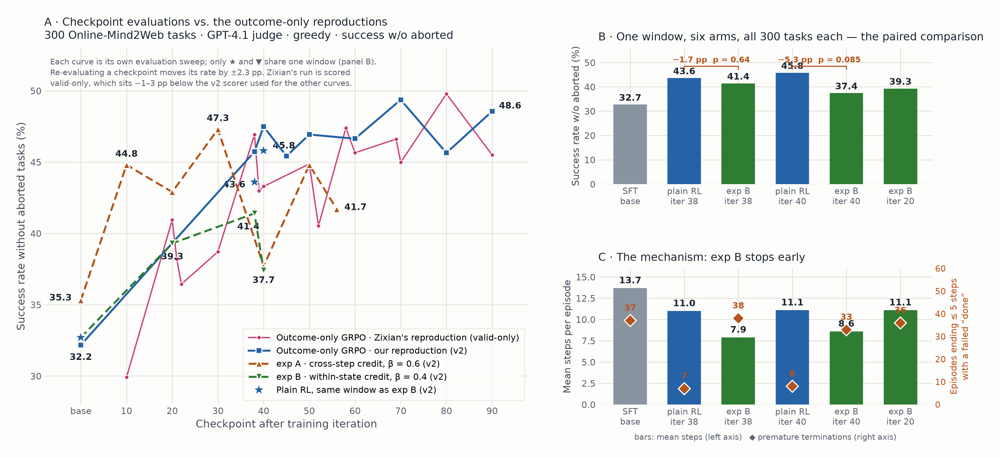

# Scalar-RM credit assignment in OpenWebRL GRPO: methods and results

Xunmei Liu · last updated 2026-09-23

This is the concise summary of two experiments that put Piotr Teterwak's Scalar Action Reward
Model (ARM) into OpenWebRL's GRPO training as a per-step credit signal. Detailed configs, run
history and every diagnostic are in the linked reports (§6). The reproduction baseline and the
inference-time selector results that these experiments build on are summarized first.



**Figure.** (A) Every checkpoint evaluation we have, against the two outcome-only reproductions
(ours, v2; Zixian's, valid-only): neither credit form tracks the baselines once past iteration 20.
Curves from different sweeps are not directly comparable — the ★/▼ points at iterations 38 and 40
are, because they share one evaluation window. (B) That window: six arms, 300 tasks each, paired McNemar. exp B is −1.7 pp and
−5.3 pp against the matched plain-RL checkpoints. (C) Why: exp B ends its episodes 3 turns earlier
and declares `done` prematurely about as often as the untrained SFT model, while plain RL learned
not to.

## 0. Setup

**OpenWebRL GRPO.** A 4B VLM web agent (OpenWebRL-4B-SFT) is trained with turn-level GRPO on live
websites: 48 groups × 5 rollouts per iteration, one GPT-4.1 outcome judgment per episode
(R ∈ {0, 1}), the group-normalized advantage A copied onto every turn, dynamic filtering of
zero-variance groups, 15-step horizon, lr 1e-6, 2 PPO epochs. Evaluation: 300 Online-Mind2Web
(OM2W) tasks, GPT-4.1 judge, greedy decoding, 30-step cap; "v2" = successes ÷ tasks that were not
aborted and not confirmed anti-bot blocks.

**Reproduction (baseline for everything below).**

| run | base (SFT) | iter 38 | iter 40 | iter 50 | iter 90 | paper Fig. 2c |
| --- | ---: | ---: | ---: | ---: | ---: | ---: |
| Hyak, v2, 30 Aug sweep | 32.2 | 45.7 | 47.5 | 46.9 | 48.6 | ≈36.5 → ≈50.5 |

Re-evaluating the same checkpoint on another day flips the verdict on 24.5% of tasks, about
±2.3 pp on one rate and ≈3.3 pp on a difference; only gaps of ~5 pp or more are readable from a
single checkpoint pair. Stage 2 (30-step horizon, iters 100–140) adds no measurable gain.

**The Scalar RM.** A Bradley–Terry value head on OpenWebRL-4B-SFT (LoRA r = 32), trained on 76.7k
(picked, rejected) pairs. Labels: GPT-5.5 picks the best of 5 actions sampled from the SFT actor
at ~3k states. The loss `−log σ(r_chosen − r_rejected)` constrains only differences between
candidates **at the same state**; no alternative is ever executed and no task outcome enters
training. Held-out pairwise accuracy 75.8%.

**What the RM is known to do (inference-time selection).** Sample 5 candidates per step at
T = 0.7, execute the RM's argmax:

| actor · benchmark | n = 1 | Scalar RM | Selection ARM |
| --- | ---: | ---: | ---: |
| OpenWebRL-4B-SFT · OM2W, Piotr's report | 33.8 | 46.3 | 51.1 |
| same, Hyak re-run (v2, nucleus) | 31.7 | 35.5 (paired p = 0.014) | 40.1 (p = 0.0001) |
| same, partner cluster, 121 paired tasks | 48.8 | 55.4 (+6.6 pp) | — |

Inside training, one expert-guided rollout per group (best-of-5 by the RM) beats its four plain
siblings 59.7% vs 49.2% (+10.4 pp, p < 0.0001, 2,331 trajectories). That measures the selection
procedure; the checkpoint trained on those rollouts has **not** been shown to beat plain RL
(+2 to +5 pp over SFT, all p ≥ 0.33, on the 92 tasks every arm completed).

---

## 1. exp A — cross-step credit (standardize across the steps of a trajectory)

**Method.** Score the action the policy actually executed at every turn with the Scalar RM and
redistribute the episode's advantage across its steps:

```
A_t = A + β · z_t
z_t = ( s_t − mean_t s ) / ( std_t s + 1e-6 ),   z_t = 0 if T < 3
```

s_t is the RM's score for the executed action at step t, standardized within the trajectory.
Σ_t z_t = 0 by construction, so the trajectory's total credit is unchanged and the policy cannot
raise its return by pleasing the RM. One reward post-processing hook in slime; β = 0 reproduces
upstream advantages bit-for-bit. β = 0.6, trained from the SFT checkpoint to iteration 56 on the
partner cluster (8×H100). RM scoring ≈ 6 min per iteration.

**Training.** Mechanism engaged: mean |βz| ÷ mean |A| = 0.60; |βz| exceeds |A| on 27.6% of turns;
the advantage's sign is flipped on 13.8% of turns (same rate in successes and failures); max |Σz|
per episode 5e-15. Mean within-episode z by action type: goto +0.66, click +0.44, scroll +0.16,
go_back −1.04. Training reward drifted down relative to the reproduction, but the sampler hands a
stronger policy harder tasks, so eval decides.

**Evaluation (300 OM2W, greedy, v2).**

| checkpoint | outcome-only GRPO | exp A (β = 0.6) | Δ |
| --- | ---: | ---: | ---: |
| SFT | 32.2 | 35.3 | +3.1 (same checkpoint, two sweeps: eval noise) |
| iter 10 | — | 44.8 | |
| iter 20 | — | 42.9 | |
| iter 30 | — | 47.3 | |
| iter 40 | 47.5 | 37.7 | −9.8 |
| iter 50 | 46.9 | 44.8 | −2.1 |

The two runs were evaluated in different sweeps. The one same-day paired comparison (iteration 38,
134 tasks where both arms produced a verdict): control 55.2%, credit 53.7%, −1.5 pp, sign-test
p = 0.87. An apparent −10.4 pp headline gap was entirely abort counts (130 vs 88), driven by
`TRUNCATED` / generation-length aborts in the credit arm, not by task performance.

**Conclusion: null.** No gain, no harm on tasks both arms completed, at a dose large enough to
flip 14% of gradients. (Orange curve in panel A of the figure.)

**Why.** Two properties of the form, both visible before the run started:

1. *Scores are not comparable across states.* The BT loss leaves each state's offset free;
   measured on selector traces, 82.9% of score variance is between states (sd 35.1) and only
   17.1% within a state (sd 16.0). A cross-step z-score mostly compares those offsets, which is
   why a reasonable click can get the lowest z of its episode.
2. *Σz = 0 per trajectory.* In a successful episode where every step was fine, about half the
   steps are still pushed negative (e.g. the scroll that revealed the answer: A_t +0.45 → −0.50).

Also: the terminal `done` step is out of distribution for the RM and systematically scored low
(mean z −0.87 even in successes).

---

## 2. exp B — within-state credit (standardize across candidate actions at the same state)

**Method.** Compute the credit the way the RM was trained: at a labeled turn, sample K = 5
responses from the policy with the same prompt and sampling parameters, score all five, and
**execute candidate 0** (never the argmax, so the scores cannot influence behaviour and the
trajectory stays on-policy):

```
d_k = 0                    if candidate k canonicalizes to the executed action
    = r_taken − r_k        otherwise                         (k = the K−1 other candidates)
c_t = clip( mean_k d_k / τ , −1, +1 )
A_t = A + β · c_t
```

- β = 0.4: the largest dose at which the sign never flips (|β·c| ≤ 0.4 < 0.447 = min |A| in any
  mixed group of five binary rewards). The judge's outcome always sets the sign; the RM only moves
  the magnitude.
- τ = 20.0: the median |r_i − r_j| over same-state candidate pairs whose actions genuinely differ
  (a global scale rather than the state's own std, so noise-level gaps stay small; 37% of states
  have five identical actions and 40% have within-state sd < 2).
- Canonical matching: clicks within 20/1000 and key-name case (`enter` / `Enter`) count as the
  same action; `done` candidates are dropped from the comparison (they score ~50 points below
  everything else and inflated c by +0.52 where present); the terminal `done` step is masked.
- 2 of each group's 5 rollouts are labeled (cost ≈ 2.6× generation, browser time unchanged).
- E[c | state] = 0 because the executed action is an exchangeable draw among the five: a
  leave-one-out baseline at the action level, replacing exp A's zero-sum-per-trajectory property.

Run `owrl_ws_beta0.4`, partner cluster 8×H100, from the SFT checkpoint, 60 iterations.

**Mechanism checks (all pass).** Sign-flip rate 0 over 45 iterations; fallback 0.01%;
executed-is-argmax 20.3% ± 1.2 (= chance for K = 5, flat over training → the policy is not learning
to pick the RM's favourite); running τ 19.9 ± 1.6 against the frozen 20; rms(β·c) / rms(A) = 0.13.

**Offline (Phase 0, before training).** 300-task shadow evaluation with K = 5 scored and candidate 0
executed: 4,504 on-policy states, 274 tasks with a GPT-4.1 verdict. Does trajectory-mean c predict
task success?

| predictor | AUROC for task success |
| --- | ---: |
| within-state credit c (the plan) | 0.531 |
| best repaired variant (drop done, tol 20, key case, kind de-bias) | 0.566 (t = 1.77, n.s.) |
| exp A's cross-step z | 0.680 (an artifact: excluding the negative terminal step leaves a positive residual that is larger in shorter, i.e. successful, episodes) |
| −T (a shorter episode) | 0.702–0.776 |
| mean state score `mean_k r(s, a_k)` | 0.859 |

Controlling for episode length, c's Wald z falls from +2.07 to +1.18. The asymmetry: the worst
step of a trajectory predicts the outcome (min c, AUROC 0.639), the best step predicts it
backwards (max c, 0.402).

**Online (paired inside GRPO groups).** Inside mixed groups, labeled successful rollouts carry
higher mean c than their failed siblings on the same task at the same iteration: +0.034 over
~600 groups, per-iteration t = 2.7 (p = 0.007); by group rather than by iteration t = 1.8, and
+0.024 (t = 1.5) after controlling for episode length. Real, small, and partly confounded by β
itself shaping the labeled rollouts.

**Checkpoint evaluation — the arbiter (six arms, one node, one window, 2026-09-23; every arm
completed all 300 tasks; abort counted as failure; paired McNemar).**

| arm | v2 rate | successes / 300 | mean steps |
| --- | ---: | ---: | ---: |
| base (SFT) | 32.7 | 66 | 13.7 |
| plain RL iter 38 | 43.6 | 89 | 11.0 |
| exp B iter 38 | 41.4 | 84 | 7.9 |
| plain RL iter 40 | 45.8 | 93 | 11.1 |
| exp B iter 40 | 37.4 | 77 | 8.6 |
| exp B iter 20 | 39.3 | 79 | 11.1 |

| paired comparison | difference | p |
| --- | ---: | ---: |
| exp B iter 38 vs plain RL iter 38 | −1.7 pp | 0.64 |
| exp B iter 40 vs plain RL iter 40 | −5.3 pp | 0.085 |
| exp B iter 38 vs SFT | +6.0 pp | 0.039 |
| plain RL iter 38 vs SFT | +7.7 pp | 0.009 |
| plain RL iter 40 vs SFT | +9.0 pp | 0.002 |

**Conclusion: no gain; point estimates lean harmful.** Both arms learn (both beat SFT); the credit
arm learns less, the same direction at both matched iterations, never significant. (Panels B and C
of the figure.)

**Mechanism: it learned to stop early.** exp B episodes run 7.9–8.6 steps against plain RL's
11.0–11.1 and end within five steps 60% more often. Plain RL learned not to declare victory early
(episodes ending ≤ 5 steps with a failed `done`: 37 → 7); exp B did not (37 → 38). Cause: the
terminal `done` is masked to c = 0, so it is the only action that can never be punished, while every
continue-the-episode action can be. Measured on the run's own credit log: episodes ending in `done`
carry Σ_t c_t = +0.19 vs −0.47 for those that do not — terminating is worth +0.26 of advantage
before the judge says anything. The per-kind offsets show the same asymmetry (back −0.18, write
−0.14, key +0.10, goto +0.08, done exactly 0, in advantage units). The designed reward-farming probe
(executed-is-argmax) stayed at chance throughout: it can see a shift in which candidate is chosen
at a state, not a shift in the action-kind mix (`done` share rose 9.7% → 14.8%).

---

## 3. Side-by-side

| | exp A: across steps | exp B: within state |
| --- | --- | --- |
| credit | z-score of the executed action's score over the trajectory's steps | clipped gap between the executed action and 4 fresh policy samples at the same state, ÷ τ |
| what the RM is asked | "is this step good compared with the other steps" — never trained | "is this action good compared with the alternatives here" — what it was trained on |
| β · dose | 0.6 · rms ratio 0.60, 13.8% sign flips | 0.4 · rms ratio 0.13, 0 sign flips |
| conserved quantity | Σ_t z_t = 0 per trajectory | E[c] = 0 per state |
| extra cost | 1 RM call per turn | 4 extra generations + 1 RM call on 40% of rollouts (≈2.6× generation) |
| offline association with outcome | 0.68 AUROC, an artifact of episode length | 0.53–0.57 AUROC; paired within-group +0.03, t ≈ 1.5–2.7 |
| checkpoint vs plain RL | −1.5 pp at iter 38 (p = 0.87), one paired point | −1.7 / −5.3 pp at iters 38 / 40 (p = 0.64 / 0.085) |
| failure mode | noise from per-state offsets; halves of good episodes pushed negative | masked `done` is the only unpunishable action → premature termination |

---

## 4. What we learned

1. **A preference ranker is not a value estimator.** The RM's within-state ranking is enough for
   best-of-5 selection, where only the ranking matters and the policy is not trained on it. As a
   per-step reward its ranking has to line up with outcomes, and it barely does: +10 pp as a
   selector vs +0.03 on a ±1 scale as a credit, from the same scores.
2. **The untrained half of the score is the informative half.** Within a GRPO group the RM's score
   *level* (not the contrast) separates successful from failed siblings by +4.4 points, z = +10 after
   controlling for length, on 13k training trajectories; the within-state contrast collapses to
   z = 1.2 under the same control. Across tasks the level is a difficulty detector (AUROC 0.86), so it
   is only usable group-relative. Φ(s′) − Φ(s) has the wrong sign in the data, which rules out
   potential-based shaping with this RM.
3. **Length confounds everything.** Successful episodes are ~1.6–2.3 turns shorter than their
   failed siblings; any per-step signal must be read after controlling for T.
4. **Asymmetries in the credit are what the policy actually learns.** Masking one action kind, or
   letting kinds carry fixed offsets, changes behaviour more than the within-state judgement does.
5. **Evaluation hygiene decides what can be concluded.** Both experiments' first headline numbers
   (−10.4 pp, −9.8 pp) were denominator or cross-sweep artifacts; only same-window, all-300-task,
   paired comparisons survived.

---

## 5. Next

- **Stage 2 (proposed, one-line change):** per-action-kind centering with `done` un-masked,
  `c_t ← c_t − mean(c over turns of the same kind)`, estimated within each iteration's batch.
  Removes the termination bonus (+0.26 → +0.18) and the per-kind offsets while keeping the
  within-group gate (t = 2.2). Zero-mean-per-trajectory was tested and rejected: it kills the
  signal (t → 1.3).
- **Stage 3 (if that still does not beat plain RL):** group-relative *level* credit from the RM
  (score only the executed action; one fifth of exp B's cost), never the difference form and never
  the raw level across tasks.
- **Principled endpoint:** an outcome-trained step model — V(s) = P(success | state) from our own
  rollouts, or a PRIME-style implicit PRM — judged first by group-standardized AUROC and the
  length-controlled z against the Scalar-RM level's z = 10.

---

## 6. Links

- Full project brief for an outside reader, with the motivation, the design reasoning, what we
  believe and our open questions: [`CREDIT_ASSIGNMENT_BRIEF_FOR_REVIEW.md`](CREDIT_ASSIGNMENT_BRIEF_FOR_REVIEW.md)
- Presentation (17 Sep): https://docs.google.com/presentation/d/1V7IygZ5JKBt9qNUPxxNRKAdn-y-GB2nL6aGjKJo0zEo/edit
- exp B status, analysis and checkpoint evaluation (partner cluster, 21–23 Sep): https://docs.google.com/document/d/1Vujexlc4HGpg-AjLkp8kvWVwMlfyX0c0v3ayja44jts/edit
- exp A analysis (`EXPA_ANALYSIS.md`) and exp B handoff (`HANDOFF_within_state_credit_for_h100_cluster.md`): in the bundles on Hyak, `/gscratch/cse/xunmei/owrl/present/`, `/gscratch/cse/xunmei/owrl/port/`
- Step viewers with real training rollouts, every candidate and the credit arithmetic: exp A https://claude.ai/artifact/AhJfyo8NQvk3Xz6ctAQJ7S · exp B https://claude.ai/artifact/MrUxeCgE9f2UCnojtW2MKf
- exp B checkpoint (resume-capable, iter 45): https://huggingface.co/XunmeiLiu/openwebrl-ws-credit-beta0.4
- Zixian Ma's ARM experiments (inference selection, filtered SFT/DPO, online turn bonuses — the last is the hard-selection analogue of exp B and also showed no reliable gain): https://github.com/zixianma/OpenWebRL/blob/arm/openwebrl/docs/ARM_SUMMARY.md
- Piotr Teterwak's action reward models: https://github.com/piotr-teterwak/action-reward-models
- OpenWebRL: https://arxiv.org/abs/2606.02031
